<div align="center">


<a href="https://www.linkedin.com/in/pedro-lucas-sales-larini-7a885b1a4"></a>
<a href="mailto:pedrolucas.larini@gmail.com"></a>


</div>

---

<div align="center">

</div>

Gosto de entender o sistema inteiro, do banco de dados à tela. Aprendo construindo: quase tudo aqui começou como uma ideia solta e virou projeto.

## Stack



## Projetos em destaque

| Projeto | O que faz | Stack |
| :-- | :-- | :-- |
| **[Sistema de Biblioteca](https://github.com/peluca2007/Projeto-2-Sistema-de-Gerenciamento-de-Biblioteca)** | API de gestão de acervo com autenticação e papéis de acesso | `Node.js` `Express` `PostgreSQL` |
| **[Portfólio de Receitas](https://github.com/peluca2007/Portfolio-receitas)** | Aplicação web em arquitetura MVC com renderização no servidor | `Node.js` `Express` `Handlebars` |
| **[Moshoku Tensei RPG](https://github.com/peluca2007/Moshoku-tensei-rpg)** · [site](https://moshoku-tensei-rpg.vercel.app) | Site de um sistema de RPG autoral, instalável e funcionando offline | `TypeScript` `Next.js` `PWA` |
| **[LivroAmigo](https://github.com/peluca2007/LivroAmigo)** · [abrir](https://peluca2007.github.io/LivroAmigo/) | Biblioteca comunitária com empréstimos, doações e eventos | `JavaScript` `localStorage` |
| **[Entre Nós](https://github.com/peluca2007/Entre-N-s)** · [jogar](https://peluca2007.github.io/Entre-N-s/) | Jogo de cartas para duas pessoas, direto no navegador | `JavaScript` `HTML` `CSS` |
| **[Moshoku Roblox](https://github.com/peluca2007/Moshoku-roblox)** | Jogo cooperativo com mundo aberto e combate por turnos | `Luau` |

<details>
<summary><b>Outros projetos</b></summary>
<br>

- [Projeto-Final-java](https://github.com/peluca2007/Projeto-Final-java): sistema de console com reservas e menus por perfil (`Java`, POO)
- [Organo](https://github.com/peluca2007/Organo): cartões de equipe com componentes reutilizáveis (`React`)
- [Pokedex](https://github.com/peluca2007/Pokedex) e [Pinhofilmes](https://github.com/peluca2007/Pinhofilmes): consumo de APIs públicas (`JavaScript`)
- [OC-Opera-o-Curiosidade](https://github.com/peluca2007/OC-Opera-o-Curiosidade): cadastro de clientes com login e painel (`JavaScript`, ES Modules)

</details>

## Experiência

```diff
+ 2025 → hoje      Diretoria de Eventos · DACOMP UTFPR
                   organização de eventos como a SECOMP e viagens técnicas

+ jun → set 2026   Líder de hacking ético e Red Team · CyberGuard UTFPR

+ 2025 → 2027      Análise e Desenvolvimento de Sistemas · UTFPR
```

## Agora

```diff
@@ em andamento @@
+ site do meu sistema de RPG
+ jogo de Roblox, uma vez por semana
+ projetos pequenos sempre que aparece uma ideia boa
```

<div align="center">

<picture>
  <source media="(prefers-color-scheme: dark)" srcset="https://raw.githubusercontent.com/peluca2007/peluca2007/output/github-snake-dark.svg" />
  <source media="(prefers-color-scheme: light)" srcset="https://raw.githubusercontent.com/peluca2007/peluca2007/output/github-snake.svg" />
  
</picture>

</div>

<details>
<summary><b>English summary</b></summary>
<br>

Software development student at UTFPR (Systems Analysis and Development, graduating Dec 2027), based in Paraná, Brazil. I build back-end and full stack applications with Node.js, Express, PostgreSQL, React and Next.js. Looking for an internship, trainee or junior role in development, security, QA, data or infrastructure. Remote or hybrid preferred.

</details>
