 

  

  

Missões secundárias: <a href="https://github.com/peluca2007/Projeto-Final-java">Projeto-Final-java</a> · <a href="https://github.com/peluca2007/Organo">Organo</a> · <a href="https://github.com/peluca2007/Pokedex">Pokedex</a> · <a href="https://github.com/peluca2007/Pinhofilmes">Pinhofilmes</a>

  

  

 

<i>Agora: tocando o site do meu RPG, mexendo no jogo de Roblox uma vez por semana e abrindo projetinhos novos sempre que a ideia aparece. Sigo ativo no DACOMP e no movimento estudantil.</i>

  

<picture>
  <source media="(prefers-color-scheme: dark)" srcset="https://raw.githubusercontent.com/peluca2007/peluca2007/output/github-snake-dark.svg" />
  <source media="(prefers-color-scheme: light)" srcset="https://raw.githubusercontent.com/peluca2007/peluca2007/output/github-snake.svg" />
  
</picture>

English summary

 

Software development student at UTFPR (Systems Analysis and Development, graduating Dec 2027), based in Paraná, Brazil. I build web apps (React, Next.js, Node.js, PostgreSQL) and game systems (an original tabletop RPG with an offline-capable PWA, and a co-op Roblox RPG in Luau). Looking for an internship, trainee or junior role in development, security, QA, data or infrastructure. Remote or hybrid preferred.

